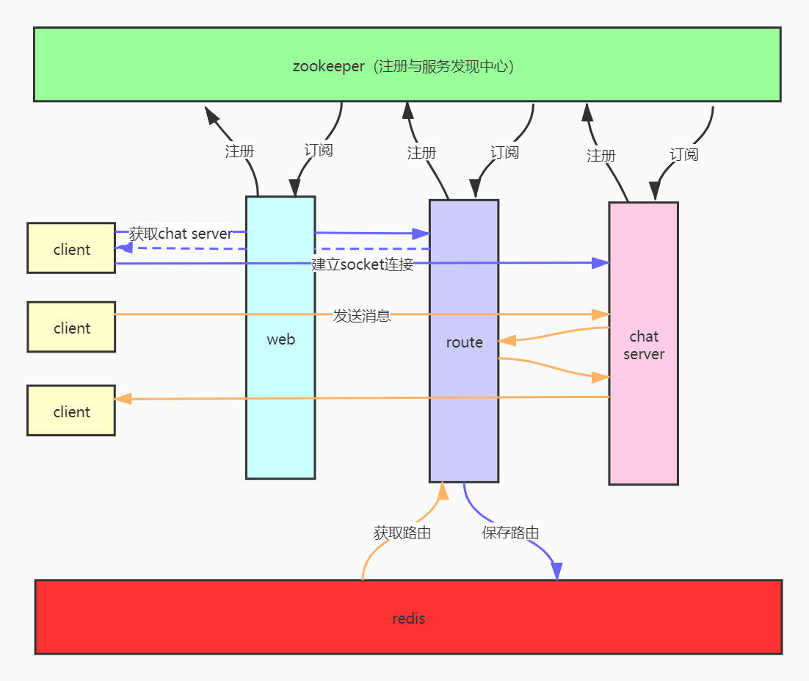

# x-netdisk

   

## 项目简介

x-netdisk 是一个前后端分离的分布式在线网盘系统，包含文件存储、图片/音视频处理、文档预览、定时清理、后台管理和 Web IM 等功能。

配套前端：

- [netdisk-app](https://github.com/xuxiake2017/netdisk-app)
- [x-netdisk-react-preview（待完善）](https://github.com/xuxiake2017/x-netdisk-react-preview)
- [netdisk-mp-preview](https://github.com/xuxiake2017/x-netdisk-mp-preview)

## 技术栈

- Java 8、Spring Boot 2.2.5、MyBatis
- ZooKeeper 3.4.14、Apache Curator 2.13.0
- Redis、MySQL 5.7、FastDFS
- Shiro、Quartz、Netty Socket.IO
- LibreOffice、JODConverter、FFmpeg
- Docker Compose

服务注册使用 Curator 的临时节点和重试机制；ZooKeeper 会话重建后会自动恢复注册节点。

## 环境要求

- JDK 8
- Maven 3.6+
- Docker 与 Docker Compose
- 建议在 Linux 环境运行 Docker 部署

`jave-1.0.2.jar` 不在公共 Maven 仓库中，首次打包前需要安装到本地仓库：

```shell
# Linux/macOS
cd x-netdisk-web/src/main/resources/lib
./install.sh

# Windows
cd x-netdisk-web\src\main\resources\lib
install.cmd
```

部署前至少检查以下配置：

- `x-netdisk-web/src/main/resources/application.yml` 中的 `fdfs-nginx-server`
- `x-netdisk-chat-server/src/main/resources/application.yml` 中注册到 ZooKeeper 的 Socket.IO 地址
- `docker-compose.yml` 中的数据库账号和密码，生产环境不要使用示例密码
- Windows Docker 若提示 MySQL 配置文件可写权限过高，请将 `conf/my.cnf` 设置为只读

## Docker 部署

1. 打包全部模块：

   ```shell
   mvn clean package -DskipTests
   ```

2. 构建镜像并启动：

   ```shell
   docker compose up --build -d
   ```

3. 查看服务状态和日志：

   ```shell
   docker compose ps
   docker compose logs -f web route chat-server quartz
   ```

`web` 镜像由 [x-netdisk-web/Dockerfile](x-netdisk-web/Dockerfile) 构建，会自动安装 LibreOffice、简体中文字体和 FFmpeg，无需预先构建本地基础镜像。Compose 会等待 ZooKeeper 健康检查通过后再启动依赖它的 Java 服务。

默认端口：

| 服务 | 端口 | 说明 |
| --- | ---: | --- |
| web | 8080 | 网盘 API |
| route | 9000 | IM 路由服务 |
| chat-server | 8100 / 9527 | HTTP / Socket.IO |
| quartz | 8200 | 定时任务服务 |
| admin | 8300 | 后台管理服务 |
| ZooKeeper | 2181 | 服务注册与发现 |
| Redis | 6379 | 缓存与会话 |
| MySQL | 3306 | 业务数据库 |

停止服务：

```shell
docker compose down
```

数据卷默认会保留；如需同时删除数据卷，确认数据不再需要后再执行 `docker compose down -v`。

## 架构介绍

- Chat 简易流程图

  

- 文件上传时序图

  

## 模块介绍

### `x-netdisk-web`

- 处理 Web 请求，使用 Redis 共享 Session
- 使用 LibreOffice/JODConverter 生成文档预览
- 使用 FFmpeg 处理视频、音频和缩略图

### `x-netdisk-route`

- 集中处理 IM 路由
- 通过 Curator 订阅服务节点
- 保存、获取用户聊天路由并分发请求

### `x-netdisk-chat-server`（可选）

- Web IM 服务端
- 提供 HTTP 与 Socket.IO 服务

### `x-netdisk-quartz`

- 使用 Quartz 定时清理用户回收站
- 使用 JDBC JobStore 支持集群调度

### `x-netdisk-common`

- 公共 Mapper、实体、工具类和 Curator 服务注册/订阅封装

### `x-netdisk-admin`

- 后台管理服务

> 扩容 route、chat-server 或 quartz 时，需要为每个实例配置唯一且可访问的服务地址，避免 ZooKeeper 注册节点冲突。

## 鸣谢

- [整体框架参考 crossoverJie/cim](https://github.com/crossoverJie/cim)
- [Shiro Session 共享实现 alexxiyang/shiro-redis](https://github.com/alexxiyang/shiro-redis)
- [FastDFS Spring Boot 解决方案 tobato/FastDFS_Client](https://github.com/tobato/FastDFS_Client)
- [Emoji Java 转换与存储方案 vdurmont/emoji-java](https://github.com/vdurmont/emoji-java)

## 更新日志

### 2026-11-17

- ZooKeeper 客户端迁移到 Apache Curator，增加连接重试和会话恢复注册
- 重构 web Docker 镜像，使用 Ubuntu 22.04 安装 LibreOffice、中文字体和 FFmpeg
- 更新 commons-fileupload、commons-io 和 metadata-extractor 依赖

### 2023-01-05

- 增加 admin 模块

### 2022-09-15

- 增加系统登录日志和短信发送日志

### 2022-07-29

- 增加 Docker 部署

### 2021-07-04

- 增加小程序登出
- 文件列表增加排序方式查询条件

### 2021-05-02

- 增加小程序一键登录注册和自动登录
- 修复大图片和音频封面缩略处理

### 2021-03-22

- 上传 TXT 文件非 UTF-8 无 BOM 时转换编码，解决文档预览乱码

### 2020-06-25

- 增加文档转 PDF

### 2020-05-20

- 增加视频缩略图
- 文件列表增加缩略图字段

### 2020-04-11

- 重构文件表结构

### 2020-03-31

- 增加 Quartz 定时任务处理回收站

### 2020-03-26

- 修复项目打包问题

### 2020-03-25

- 将 Socket.IO 地址注册到 ZooKeeper
- 增加 README 和数据库脚本

如果这个项目对你有帮助，欢迎 Star。
