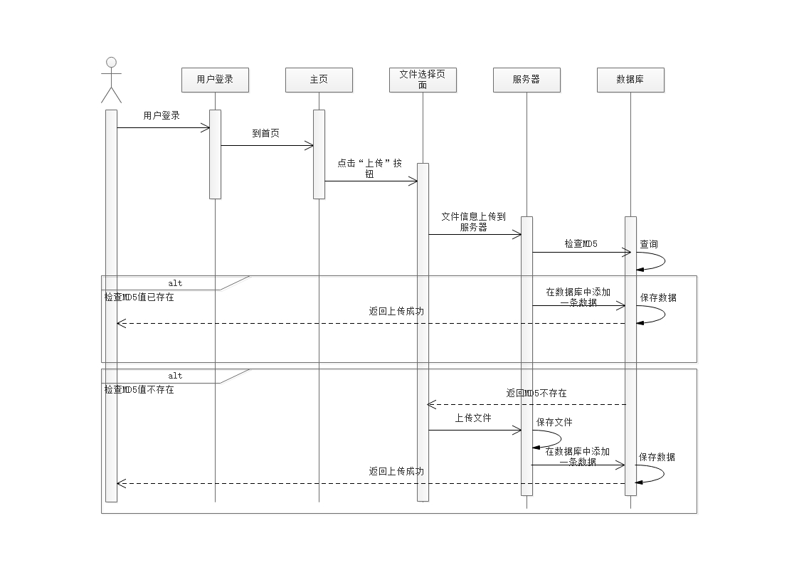

# x-netdisk

   

## 项目简介

x-netdisk 是一个前后端分离的分布式在线网盘系统，包含文件存储、图片/音视频处理、文档预览、定时清理、后台管理和 Web IM 等功能。

配套前端：

- [netdisk-app](https://github.com/xuxiake2017/netdisk-app)
- [x-netdisk-react-preview（待完善）](https://github.com/xuxiake2017/x-netdisk-react-preview)
- [netdisk-mp-preview](https://github.com/xuxiake2017/netdisk-mp-preview)

## 技术栈

- Java 8、Spring Boot 2.2.5、MyBatis
- ZooKeeper 3.4.14、Apache Curator 2.13.0
- Redis、MySQL 5.7、FastDFS
- Shiro、Quartz、Netty Socket.IO
- LibreOffice、JODConverter、FFmpeg
- Docker Compose

服务注册使用 Curator 的临时节点和重试机制；ZooKeeper 会话重建后会自动恢复注册节点。

## 环境要求

- JDK 8
- Maven 3.6+
- Docker 与 Docker Compose
- 建议在 Linux 环境运行 Docker 部署

`jave-1.0.2.jar` 不在公共 Maven 仓库中，首次打包前需要安装到本地仓库：

```shell
# Linux/macOS
cd x-netdisk-web/src/main/resources/lib
./install.sh

# Windows
cd x-netdisk-web\src\main\resources\lib
install.cmd
```

部署前至少检查以下配置：

- `.env` 中的数据库密码、Token 密钥和对外访问地址
- `x-netdisk-chat-server/src/main/resources/application.yml` 中注册到 ZooKeeper 的 Socket.IO 地址
- 生产环境不要使用 `.env.example` 中的示例密码
- Windows Docker 若提示 MySQL 配置文件可写权限过高，请将 `conf/my.cnf` 设置为只读

## Docker 部署

1. 创建生产环境配置：

   ```shell
   cp .env.example .env
   ```

   Windows PowerShell 使用：

   ```powershell
   Copy-Item .env.example .env
   ```

   至少需要修改 `MYSQL_ROOT_PASSWORD`、`MYSQL_PASSWORD`、`DB_PASSWORD` 和 `TOKEN_SECRET`，不要将 `.env` 提交到代码仓库。

2. 打包全部模块：

   ```shell
   mvn clean package -DskipTests
   ```

3. 构建镜像并启动：

   ```shell
   docker compose up --build -d
   ```

4. 查看服务状态和日志：

   ```shell
   docker compose ps
   docker compose logs -f web route chat-server quartz
   ```

`web` 镜像由 [x-netdisk-web/Dockerfile](x-netdisk-web/Dockerfile) 构建，会自动安装 LibreOffice、简体中文字体和 FFmpeg，无需预先构建本地基础镜像。Compose 会等待 ZooKeeper 健康检查通过后再启动依赖它的 Java 服务。

### Web 环境变量

常用配置均通过根目录 `.env` 管理：

| 配置 | 默认值 | 说明 |
| --- | --- | --- |
| `PUBLIC_SERVER_HOST` | `http://127.0.0.1:8181` | 前端对外访问地址，用于邮件链接等场景 |
| `SESSION_COOKIE_SECURE` | `false` | HTTPS 生产环境设为 `true`；使用 HTTP 时必须为 `false` |
| `FASTDFS_TRACKER` | `fastdfs_tracker:22122` | FastDFS Tracker 地址 |
| `FASTDFS_CONNECT_TIMEOUT` | `3000` | FastDFS 建立连接超时，单位毫秒 |
| `FASTDFS_SO_TIMEOUT` | `30000` | FastDFS 文件读写超时，单位毫秒 |
| `FASTDFS_NGINX_SERVER` | `http://192.168.81.30:8888` | FastDFS 文件访问地址 |
| `MULTIPART_MAX_FILE_SIZE` | `500MB` | Spring 接收的单文件上限，不应低于业务层 VIP 文件上限 |
| `MULTIPART_MAX_REQUEST_SIZE` | `1024MB` | 单次上传请求总大小上限 |
| `RECYCLE_DELAY_TIME` | `2592000000` | 回收站保留时间，默认 30 天，单位毫秒 |
| `RECYCLE_RECONCILE_INTERVAL` | `60000` | 扫描遗漏的过期回收站记录间隔，单位毫秒 |
| `STORAGE_DELETE_RETRY_INTERVAL` | `60000` | 重试删除 FastDFS 物理文件的扫描间隔，单位毫秒 |
| `MEDIA_CORE_POOL_SIZE` | `2` | 音视频转换核心线程数 |
| `MEDIA_MAX_POOL_SIZE` | `4` | 音视频转换最大线程数 |
| `MEDIA_QUEUE_CAPACITY` | `20` | 音视频转换等待队列长度 |
| `EMAIL_CODE_EXPIRE` | `600000` | 注册邮箱验证码有效期，单位毫秒 |
| `EMAIL_SEND_INTERVAL` | `60000` | 同一邮箱发送验证码的最短间隔，单位毫秒 |
| `EMAIL_MAX_VERIFY_ATTEMPTS` | `5` | 单个邮箱验证码允许的最大校验次数 |
| `SHARE_MAX_PASSWORD_ATTEMPTS` | `5` | 同一来源连续输入错误分享提取码的最大次数 |
| `SHARE_PASSWORD_LOCK_TIME` | `600000` | 分享提取码错误次数超限后的锁定时间，单位毫秒 |
| `SMS_SEND_INTERVAL` | `60000` | 同一手机号发送短信的最短间隔，单位毫秒 |
| `SMS_MNS_ENABLED` | `false` | 是否启动阿里云短信回执监听 |

Web 服务不再内置 CORS 过滤器。浏览器端建议通过 Nginx 等反向代理将前端和 API 部署为同源地址；如果前后端使用不同域名，需要在网关或反向代理层配置 CORS。

生产环境通过 HTTPS 访问时应设置 `SESSION_COOKIE_SECURE=true`。如果浏览器直接使用 HTTP 访问却开启该选项，登录后的 Session Cookie 不会被发送，会表现为登录后仍提示未登录。

默认端口：

| 服务 | 端口 | 说明 |
| --- | ---: | --- |
| web | 8080 | 网盘 API |
| route | 9000 | IM 路由服务 |
| chat-server | 8100 / 9527 | HTTP / Socket.IO |
| quartz | 8200 | 定时任务服务 |
| admin | 8300 | 后台管理服务 |
| ZooKeeper | 2181 | 服务注册与发现 |
| Redis | 6379 | 缓存与会话 |
| MySQL | 3306 | 业务数据库 |

停止服务：

```shell
docker compose down
```

数据卷默认会保留；如需同时删除数据卷，确认数据不再需要后再执行 `docker compose down -v`。

从旧版本升级已有数据库时，需要依次执行 [sql/upgrade_20261118_drop_user_file_path.sql](sql/upgrade_20261118_drop_user_file_path.sql)、[sql/upgrade_20261118_file_tree_consistency.sql](sql/upgrade_20261118_file_tree_consistency.sql)、[sql/upgrade_20261119_user_email_unique.sql](sql/upgrade_20261119_user_email_unique.sql)、[sql/upgrade_20261120_share_hardening.sql](sql/upgrade_20261120_share_hardening.sql) 和 [sql/upgrade_20261120_recycle_hardening.sql](sql/upgrade_20261120_recycle_hardening.sql)。全新部署无需执行升级脚本。添加唯一索引前如存在重复邮箱或重复分享 ID，需要先人工确认并清理重复数据。

## 架构介绍

- Chat 简易流程图

  

- 文件上传时序图

  

## 模块介绍

### `x-netdisk-web`

- 处理 Web 请求，使用 Redis 共享 Session
- 使用 LibreOffice/JODConverter 生成文档预览
- 使用 FFmpeg 处理视频、音频和缩略图
- 文件下载采用流式传输，音视频转换和邮件发送使用有界线程池
- 新密码使用 BCrypt；旧 MD5 密码在用户成功登录后自动升级

Web API 已明确限制 HTTP 方法：查询使用 `GET`，创建和提交使用 `POST`，更新使用 `PUT`，删除使用 `DELETE`。旧版前端如果曾使用 GET 调用修改类接口，需要同步调整请求方法。

创建分享使用 `POST /share/shareFile`，参数为 `fileKey`、`isPublic`（`0` 私密、`1` 公开）和可选的 `expireDays`（`0` 或不传表示永久，最大 365 天）。分享下载使用 `POST /share/download`，私密分享在请求体中提交 `sharePwd`，避免提取码出现在 URL 和访问日志中。普通下载和分享下载均支持文件夹流式打包为 ZIP。

邮箱注册采用两步流程：先 `POST /verify/sendCodeToEmail` 提交 `email` 和 `imgCode`，再提交 `email`、`password` 和 `emailCode`；Web 端调用 `POST /user/register`，APP/H5 端调用 `POST /user/registerApp`。两个入口使用相同注册逻辑，邮箱验证码验证成功后才会创建账号，验证码只能使用一次。

### `x-netdisk-route`

- 集中处理 IM 路由
- 通过 Curator 订阅服务节点
- 保存、获取用户聊天路由并分发请求

### `x-netdisk-chat-server`（可选）

- Web IM 服务端
- 提供 HTTP 与 Socket.IO 服务

### `x-netdisk-quartz`

- 使用 Quartz 定时清理用户回收站
- 使用 JDBC JobStore 支持集群调度

### `x-netdisk-common`

- 公共 Mapper、实体、工具类和 Curator 服务注册/订阅封装

### `x-netdisk-admin`

- 后台管理服务

> 扩容 route、chat-server 或 quartz 时，需要为每个实例配置唯一且可访问的服务地址，避免 ZooKeeper 注册节点冲突。

## 鸣谢

- [整体框架参考 crossoverJie/cim](https://github.com/crossoverJie/cim)
- [Shiro Session 共享实现 alexxiyang/shiro-redis](https://github.com/alexxiyang/shiro-redis)
- [FastDFS Spring Boot 解决方案 tobato/FastDFS_Client](https://github.com/tobato/FastDFS_Client)
- [Emoji Java 转换与存储方案 vdurmont/emoji-java](https://github.com/vdurmont/emoji-java)

## 更新日志

### 2026-11-20

- 加固分享有效性、提取码限流、过期与公开分享、唯一约束和原子统计
- 普通下载与分享下载支持文件夹流式打包 ZIP，分享下载改为 POST 避免提取码进入 URL

### 2026-11-19

- APP/H5 注册改为邮箱验证码验证成功后创建账号，增加发送限流、校验次数限制和邮箱唯一约束
- 默认头像改由客户端兜底展示，数据库 `avatar` 字段保持为 `NULL`

### 2026-11-18

- 加固 Shiro 认证、分享规则及文件/回收站资源归属校验
- 密码升级为 BCrypt，并兼容旧 MD5 密码的登录迁移
- 文件下载改为流式传输，音视频转换和邮件发送改用有界线程池
- 增加短信频率限制、Session Cookie 安全配置及外部调用超时
- Web API 明确限制 HTTP 方法，移除应用内 CORS 过滤器
- 完善 Docker 环境变量和大文件上传配置

### 2026-11-17

- ZooKeeper 客户端迁移到 Apache Curator，增加连接重试和会话恢复注册
- 重构 web Docker 镜像，使用 Ubuntu 22.04 安装 LibreOffice、中文字体和 FFmpeg
- 更新 commons-fileupload、commons-io 和 metadata-extractor 依赖

### 2023-01-05

- 增加 admin 模块

### 2022-09-15

- 增加系统登录日志和短信发送日志

### 2022-07-29

- 增加 Docker 部署

### 2021-07-04

- 增加小程序登出
- 文件列表增加排序方式查询条件

### 2021-05-02

- 增加小程序一键登录注册和自动登录
- 修复大图片和音频封面缩略处理

### 2021-03-22

- 上传 TXT 文件非 UTF-8 无 BOM 时转换编码，解决文档预览乱码

### 2020-06-25

- 增加文档转 PDF

### 2020-05-20

- 增加视频缩略图
- 文件列表增加缩略图字段

### 2020-04-11

- 重构文件表结构

### 2020-03-31

- 增加 Quartz 定时任务处理回收站

### 2020-03-26

- 修复项目打包问题

### 2020-03-25

- 将 Socket.IO 地址注册到 ZooKeeper
- 增加 README 和数据库脚本

如果这个项目对你有帮助，欢迎 Star。
